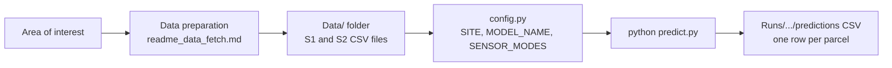
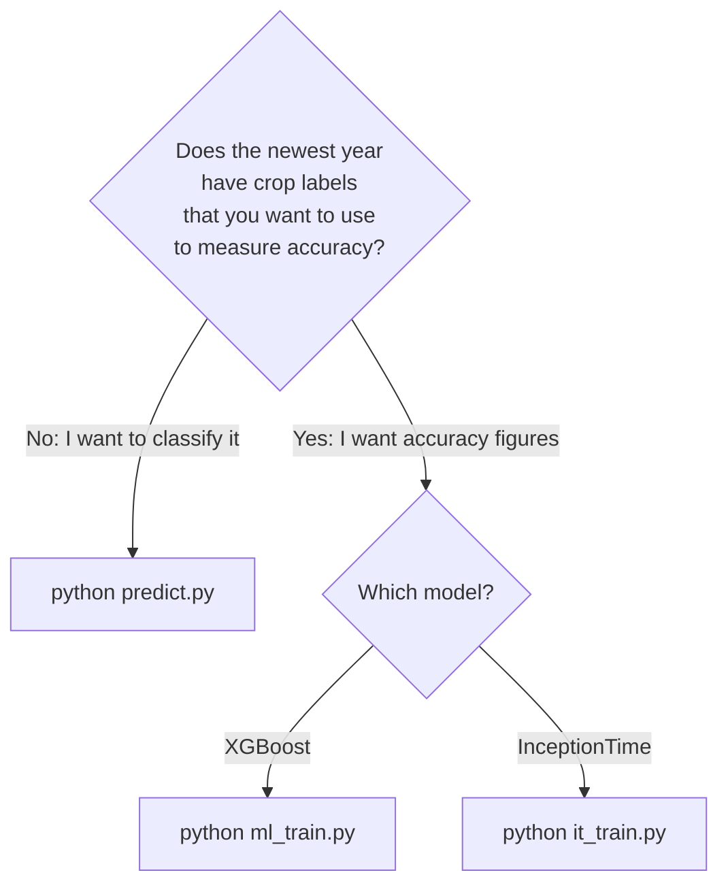
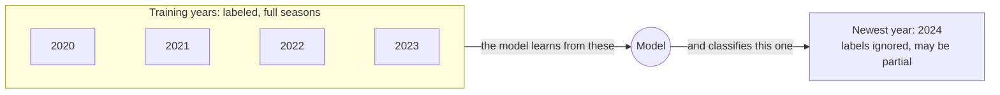
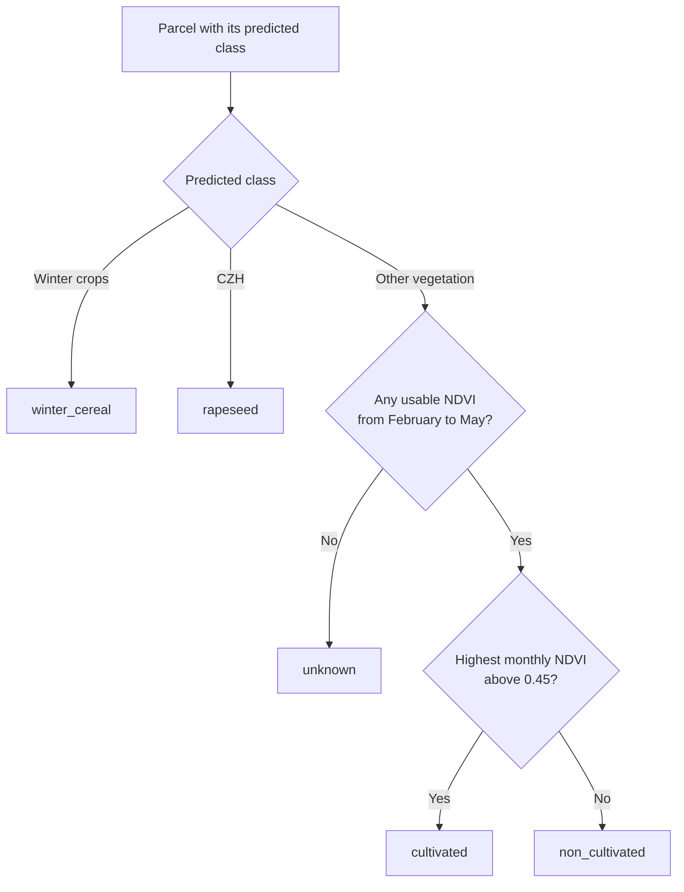
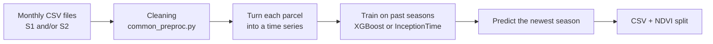
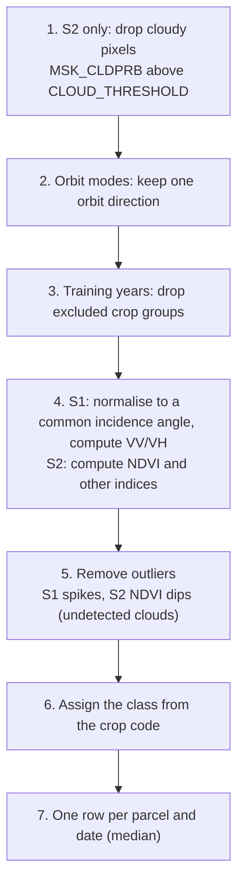
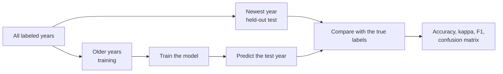
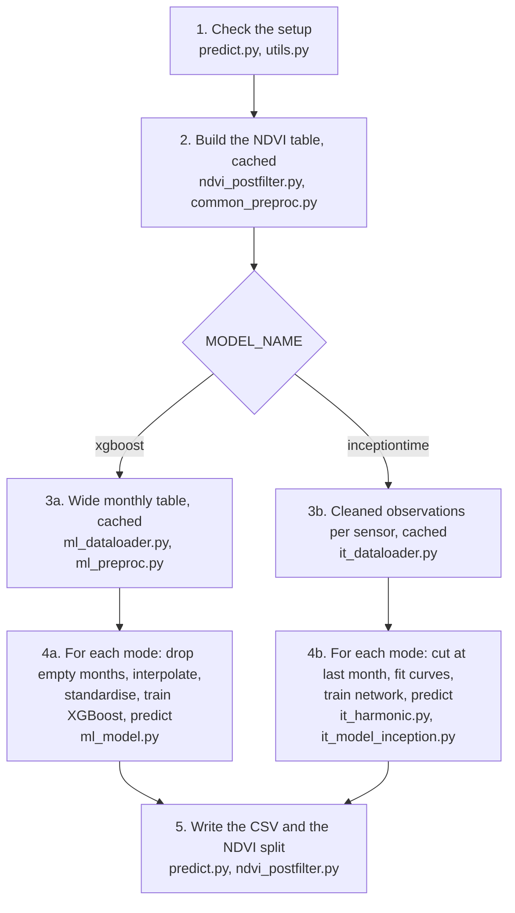

# Winter Crops Classifier

Looks at satellite images of farm parcels over a growing season and decides,
for each parcel, what kind of crop it is.

| Class | Meaning |
|---|---|
| **Winter crops** | Wheat, barley and other winter cereals |
| **CZH** | Winter rapeseed |
| **Other vegetation** | Everything else (maize, grassland, fallow, ...) |

It uses radar (Sentinel-1), optical (Sentinel-2), or both.

**The idea in one paragraph.** You give it several past seasons where the
crops are known, plus a newer season where they are not. It learns from the
past and writes a CSV with a predicted class for every parcel of the new
season. The new season does not need to be finished: the tool uses whatever
months exist.



## 1. Quick start

1. **Install** (Python 3.11 or 3.12):
```bash
   python -m venv venv
   venv\Scripts\activate                 # Linux/Mac: source venv/bin/activate
   pip install -r requirements.txt
   pip install -r requirements_it.txt    # only for InceptionTime
```
   InceptionTime is practical only with a GPU. In that case, install `torch`
   with the command from pytorch.org that matches your CUDA version. XGBoost
   runs fine on a normal CPU.
2. **Get your data** into `Data/` (section 2). If you don't have it yet,
   follow [`readme_data_fetch.md`](readme_data_fetch.md).
3. **Edit three settings** in `config.py`: `SITE`, `MODEL_NAME`,
   `SENSOR_MODES` (section 3).
4. **Run:**
```bash
   python predict.py
```
5. **Open the result:**
   `Runs/<timestamp>_.../predictions_<year>_<model>_<mode>.csv` (section 4).

### **Note :** The first run on a site takes long because of reading satellite data CSVs and cache building.

### Which command do I run?



| I want to... | Command | Newest year needs labels? |
|---|---|---|
| **Classify a new season** (normal use) | `python predict.py` | No |
| Measure XGBoost accuracy on a labeled year | `python ml_train.py` | **Yes** |
| Measure InceptionTime accuracy on a labeled year | `python it_train.py` | **Yes** |

The scripts read the years from the file names. **The newest year is always
the one predicted** (or tested). All older years are used for training and must
have crop labels.



> Example: with labeled data for 2020-2024 plus an unlabeled 2025, `predict.py`
> trains on 2020-2024 and predicts 2025. The evaluation scripts would pick
> 2025 as the test year and fail, because it has no labels (section 6).

---

## 2. Your data

### Folder layout

All `.py` files stay together, with a `Data/` folder next to `config.py`:

```
project/
├── config.py, predict.py, ... (all .py files)
├── requirements.txt, requirements_it.txt
└── Data/
    ├── S1_extract_<SITE>/    S1_<SITE>_<year>_<YYYY-MM>[_part<n>of<N>].csv
    └── S2_extract_<SITE>/    S2_<SITE>_<year>_<YYYY-MM>[_part<n>of<N>].csv
```

`<SITE>` must be identical to `SITE` in `config.py`. You only need the sensors
your chosen mode uses. The folders `cache_/` and `Runs/` are created
automatically.

### File names

One file per sensor, per month, and per tile if you used the data-preparation
scripts, for example `S2_Bapaume_2023_2023-04_part1of4.csv`.

- The first 4-digit number is the **agricultural year**, meaning the harvest
  year: `2023` is September 2022 to June 2023.
- The `YYYY-MM` part is the month. Only September to June is accepted.
- The `_part<n>of<N>` suffix is optional. Parts of the same month are combined
  automatically.

A file that does not match stops the run with a clear message.

### Columns

| Sensor | Required columns |
|---|---|
| S1 | `id_parcel`, `date`, `VV`, `VH`, `angle`, `code_cultu`, `code_group`. For orbit modes also `orbit_direction` (`ASCENDING` / `DESCENDING`). |
| S2 | `id_parcel`, `date`, `B2 B3 B4 B5 B6 B7 B8 B8A B11 B12`, `MSK_CLDPRB` (0-100), `code_cultu`, `code_group`. |

- Each row is one parcel on one acquisition date.
- S1 `VV` and `VH` must be **linear** values, not dB.
- `code_cultu` and `code_group` are French RPG crop codes. They are required in
  training years. In the year to predict they are ignored and may be missing.

### Training years vs. predict year

- **Newest year** = year to predict. Always treated as unlabeled, even if it
  contains crop codes. It can be partial (for example September to March): no
  setting is needed.
- **All other years** = training years. They need labels, and each should be a
  full season. Use as many as you have.
- The training years together must contain all three classes.

---

## 3. Configure (`config.py`)

Only three settings matter for normal use.

**`SITE`** selects `Data/S1_extract_<SITE>` and `Data/S2_extract_<SITE>`.

**`MODEL_NAME`**

| Value | When to use | Hardware |
|---|---|---|
| `"xgboost"` (recommended) | Default. Fast, works on monthly features. | CPU |
| `"inceptiontime"` | Deep-learning alternative. | GPU practical, slow on CPU |

**`SENSOR_MODES`** is a list. Each entry trains one model and writes one CSV.

| Mode | Uses | Needs |
|---|---|---|
| `"S1"` | Radar, both orbits merged | S1 files |
| `"S2"` | Optical | S2 files |
| `"both"` | Radar + optical | both |
| `"S1_ASC"`, `"S1_DESC"` | Radar, one orbit direction | S1 with `orbit_direction` |
| `"S1_SPLIT_ORBIT"` | Radar, ascending and descending as separate features | S1 with `orbit_direction` |
| `"both_split_orbit"` | Radar split by orbit + optical | both, with `orbit_direction` |

If a mode needs data you don't have, the run stops immediately and says so.

**Crop definitions** (`WINTER_CROPS`, `CZH_CROPS`, `EXCLUDED_CODE_GROUPS`)
decide which `code_cultu` values belong to which class. Anything not listed is
"Other vegetation", and the excluded groups (vines, orchards, miscellaneous,
fallow) are removed from training. They match the French registry.

> ⚠️ A wrong mapping does **not** raise an error. It silently produces almost
> only "Other vegetation". On your first run, check that the printed class
> distribution looks plausible.

Everything else has tested defaults (section 8).

---

## 4. Run and read the result

```bash
python predict.py
```

Every run creates a new folder `Runs/<timestamp>_<model>_<site>_.../`:

```
Runs/20261014_101942_xgboost_Bapaume_bands_['median']/
└── predictions_2024_xgboost_both_split_orbit.csv     one CSV per sensor mode
```

Each CSV has **one row per parcel found in the predict-year files**. At the end
of each mode the log prints the result, for example:

```
[predict] 150,757 classified / 150,757 parcels (100.0%) --> .../predictions_2024_xgboost_both_split_orbit.csv
pred_name
Other vegetation    92093
Winter crops        50675
CZH                  7989
```

### Columns

| Column | Meaning |
|---|---|
| `id_parcel`, `agri_year` | The parcel and the predicted year |
| `classified` | `True` if a prediction was made |
| `reason` | Why not, when `classified` is `False` |
| `pred_class`, `pred_name` | 0 / 1 / 2 = Winter crops / CZH / Other vegetation |
| `confidence` | Highest class probability |
| `proba_winter_crops`, `proba_czh`, `proba_other_vegetation` | Probability of each class |
| `veg_subclass`, `ndvi_max_window`, `ndvi_max_month` | NDVI split of "Other vegetation" (below) |
| *XGBoost only:* `window_s1`, `window_s2`, `n_valid_months_s1`, `n_valid_months_s2` | Months used, and how many have real data for this parcel |
| *InceptionTime only:* `window`, `n_valid_obs_<sensor>` | Season window used, and real acquisitions for this parcel |

### How much to trust a prediction

- **`confidence` is a model score, not an accuracy.** A parcel with 0.95 is not
  95% likely to be correct. Use it to rank parcels, not as a probability.
- **`n_valid_months_*` / `n_valid_obs_*` show how much real data a prediction
  rests on.** Months with no usable observation (mostly cloudy optical months)
  are filled in artificially. Few real months means a less reliable
  prediction. Filter on these columns if you need more certainty.
- **`classified = False`** means no prediction was possible:
  - *XGBoost:* a required sensor has no real month at all.
  - *InceptionTime:* a sensor has fewer than 10 valid observations in the
    window. This is stricter, and such parcels are also left out of training.

### The NDVI split of "Other vegetation"

The classifier cannot tell cultivated land from natural vegetation inside
"Other vegetation". When `NDVI_POSTFILTER = True` (default) and S2 files exist
for the predict year, `veg_subclass` adds a simple rule:



- Starting in February avoids counting winter cover crops.
- `unknown` parcels usually have some S2 months but none between February and
  May (typically persistent cloud with the strict `CLOUD_THRESHOLD = 1`). They
  have fewer real S2 months than other parcels, so their class prediction is
  also less reliable.
- The split **never changes `pred_class`**. It only adds information.

---

## 5. How it works

### 5.1 The big picture



The two models differ in how they turn a parcel into a time series:

| | XGBoost | InceptionTime |
|---|---|---|
| **Representation** | One value per feature and month (monthly median), as one wide table row per parcel | A smooth seasonal curve per parcel, sampled every 6 days |
| **Missing data** | Interpolated between nearest real months | The curve is fitted on real observations only. Too few observations leave the parcel unclassified. |
| **Model** | Gradient-boosted trees, class-balanced weights | 1D convolutional network with inception blocks, class-weighted loss |
| **Speed** | Fast, CPU | Slow without a GPU |

### 5.2 Cleaning (shared by both models, `common_preproc.py`)

Every monthly file goes through the same steps. Changing this file affects
both models.



### 5.3 Early-season prediction (nothing to configure)

The months that actually contain data in the newest year define the window.
The model is trained on exactly those months for every training year, so it
never relies on information that will not exist at prediction time.

```
Month               Sep Oct Nov Dec Jan Feb Mar Apr May Jun
Training years       ●   ●   ●   ●   ●   ●   ●   ●   ●   ●    full seasons
Predict year         ●   ●   ●   ●   ●   ●   ●   ·   ·   ·    data ends in March
Window actually used ●   ●   ●   ●   ●   ●   ●   ×   ×   ×    April-June ignored
                                                               for all years
```

- *XGBoost:* a month is used if at least one parcel has data in it in the
  predict year. Each sensor keeps its own months.
- *InceptionTime:* observations after the last month with data are dropped for
  all years. With two sensors, the shorter window applies to both.
- A month file with no usable observation counts as missing.

### 5.4 Missing data

- *XGBoost:* empty months are filled by linear interpolation between the
  nearest real months (edges repeat the nearest real value). This happens
  after the window is chosen, so months outside it never influence a value.
  Anything still missing gets the training median.
- *InceptionTime:* a smooth seasonal curve is fitted to each parcel's real
  observations and sampled every 6 days. Parcels with too few observations are
  left unclassified, not filled with an average curve.

### 5.5 The models

- **XGBoost:** one monthly median per feature, arranged in a wide table,
  standardised, with class weights to balance the three classes.
- **InceptionTime:** a 1D convolutional network. Inputs are standardised per
  time step, the loss is class-weighted, and a random 20% of the training
  parcels decides when to stop training.

---

## 6. Measuring accuracy (optional)

`predict.py` computes no accuracy, because the predicted year has no labels. To
measure accuracy, use a **labeled** newest year:

```bash
python ml_train.py   # XGBoost       (needs MODEL_NAME = "xgboost")
python it_train.py   # InceptionTime
```



If `Data/` also holds an unlabeled year, **move its files out first**,
otherwise the evaluation fails or gives meaningless metrics.

Results are in `Runs/<run>/`: `trial_metrics.csv` (accuracy, kappa, F1 per
class), confusion matrices, plots, the saved model, and
`predictions_<year>.csv` (true vs. predicted). For leave-one-year-out with
XGBoost, change the last line of `ml_train.py` to `main(single=False)`.

`it_train.py` fills sparse parcels with a median (as in the report), whereas
`predict.py` leaves them unclassified, so InceptionTime numbers from the two
are not directly comparable.

---

## 7. What happens when you run each script

Steps in order, with the file doing each step in brackets. Every script first
loads `config.py`, which fixes the output folder name with a timestamp, so
every run writes to a **new** `Runs/` folder.

### 7.1 `python predict.py`



1. **Check the setup.** Reads the file names, takes the newest year as the
   predict year, and verifies that every mode has the files it needs for that
   year (and the `orbit_direction` column for orbit modes).
2. **Build the NDVI table** if `NDVI_POSTFILTER` is on: monthly NDVI per parcel
   for the predict year.
3. **Prepare the data**, depending on the model:
   - *XGBoost:* load the cleaned observations, compute the monthly median per
     parcel and feature, and arrange them in one wide table (one row per
     parcel and year, one column per feature and month). The log shows
     `[cache] Loading feature matrix` when a saved table is reused.
   - *InceptionTime:* load the cleaned observations for each sensor.
4. **For each sensor mode, train and predict:**
   - *XGBoost:*
     1. drop the months with no data at all in the predict year;
     2. select the columns of the mode;
     3. count each parcel's real months;
     4. fill empty months by interpolation;
     5. fill anything still missing with the training median;
     6. standardise the features;
     7. train XGBoost on the training years;
     8. compute class probabilities for the predict year.
   - *InceptionTime:*
     1. find the last month with data in the predict year and cut all years
        there;
     2. fit a seasonal curve to each parcel and sample it every 6 days;
     3. align the sensors and mark parcels with too few observations as
        unusable;
     4. train the network (80% of training parcels to learn, 20% to decide
        when to stop);
     5. compute class probabilities for the predict year.
5. **Write the result.** Build the CSV, add parcels that disappeared during
   filtering as `classified = False`, apply the NDVI split, save the file.

### 7.2 `python ml_train.py` (XGBoost evaluation)

1. Check that `SENSOR_MODES` are valid.
2. Build or load the wide feature table, as in step 3 above, with every year
   treated as labeled. Parcels without a label are removed.
3. Plot the class distribution per year.
4. For each mode, train on all years except the newest and test on the newest
   [`ml_train.py`, `ml_model.py`]: interpolate gaps, make time-series plots,
   select columns, fill and standardise, train, then print the classification
   report and confusion matrix.
5. Save the metrics (`trial_metrics.csv`), plots, the model and
   `predictions_<year>.csv`.

### 7.3 `python it_train.py` (InceptionTime evaluation)

1. Find the years from the file names.
2. For each mode, build the seasonal-curve tensor for all years
   [`it_dataloader.py`, `it_harmonic.py`]: cleaned observations, then a curve
   fitted to each parcel and year over the full September to June season. Both
   steps are cached.
3. Train on all years except the newest, with a random 20% of the training
   parcels kept aside to decide when to stop, and test on the newest year
   [`it_model_inception.py`].
4. Save the metrics, plots, the model and `predictions_<year>.csv`.

### 7.4 Caches

`cache_/` stores the slow intermediate results. A cache is reused only if the
data files (names and sizes) and the relevant settings are unchanged, so adding
a month file or changing a setting rebuilds it automatically.

| Cache | Used by | Notes |
|---|---|---|
| XGBoost wide table | `predict.py`, `ml_train.py` | Each script builds its **own** table once (they treat the newest year differently), then reuses it. |
| NDVI table | `predict.py` | Built once per predict year. |
| InceptionTime cleaned observations | `predict.py`, `it_train.py` | Same rule: one build per script, then reused. Switching between the two scripts costs one rebuild. |
| InceptionTime curve tensor | `it_train.py` only | `predict.py` builds its own tensor, cut at the last available month, and does not cache it. |

The log tells you what happened: `[cache] Loading ...` means a saved result was
reused. If a run seems to rebuild every time, compare the data files and
settings with the previous run.

> **If you edit the code in `common_preproc.py`, delete `cache_/`.** The cache
> only notices changes to data and settings, not to code.

---

## 8. Advanced settings

Defaults produced the reported results. Change them deliberately.

**Preprocessing** (caches rebuild automatically)

| Setting | Default | Effect |
|---|---|---|
| `CLOUD_THRESHOLD` | `1` | Keeps S2 rows with `MSK_CLDPRB` at or below this. `1` is very clean but sparse. Higher gives more, noisier observations. |
| `S1_SPIKE_FILTER`, `S1_SPIKE_THRESHOLD_DB` | `True`, `5.0` | Removes S1 acquisitions that jump more than this (dB) against both neighbours. |
| `S2_NDVI_DIP_FILTER`, `S2_NDVI_DIP_THRESHOLD` | `True`, `0.4` | Removes S2 acquisitions with a sudden NDVI dip on both sides. |
| `REF_ANGLE` | `None` | S1 reference angle. `None` computes it from the training years. |
| `S2_MODE` | `"bands"` | `"bands"`, `"indices"` (NDVI, NDMI, NDRE, PSRI, NDYI), `"bands_10m"`, `"bands_10m+indices"`. |

**NDVI split** (does not change predictions): `NDVI_POSTFILTER` (`True`),
`NDVI_FILTER_START_MONTH` / `END_MONTH` (`m02` / `m05`),
`NDVI_FILTER_THRESHOLD` (`0.45`).

**Models:** `BEST_PARAMS_XGB` (keep `objective: "multi:softprob"`, since the
probability columns need it), `RANDOM_SEED`, and the `IT_*` settings for
InceptionTime. A curve fit needs at least `2 × IT_HARMONIC_N_PER_SEASON + 2`
valid observations, so a higher order leaves more parcels unclassified.

**Do not change without editing code**

| Setting | Why |
|---|---|
| `CLASS_NAMES` / number of classes | Ids 0/1/2 are hard-coded in `common_preproc.assign_class`, `ndvi_postfilter.py`, `plots.py`. |
| `MONTH_ORDER` | Defines the September-June season used everywhere. |
| `S1_NUMERIC_COLS` | The XGBoost branch assumes `"angle"` is the last entry. |
| `AGG_FUNCS` | Only `["median"]` was tested. |

---

## 9. Known limitations

- The crop mapping is for the French RPG registry.
- In the predict year, vines, orchards and other excluded groups cannot be
  filtered (there is no declaration), so they come out as "Other vegetation".
- A parcel can change crop between years, so the same parcel appearing in
  training and predict years is normal.
- Predictions on an incomplete season may be less accurate, because fewer
  months of observations are available.
- `confidence` is not a calibrated accuracy.
- The NDVI split needs S2 files for the predict year and data in February.

---

## 10. Troubleshooting

| Message or symptom | Cause and fix |
|---|---|
| `File validation failed` | File names or months do not match section 2. |
| `Mode 'X' needs S2 but there are no S2 files for <year>` | The newest year has no S2 files. Use an S1 mode or add them. |
| `needs an 'orbit_direction' column` | Use `S1`, `S2` or `both`, or add the column. |
| Nearly everything is "Other vegetation" | Crop codes do not match `WINTER_CROPS` / `CZH_CROPS`. |
| `No labeled training parcels found` | Training years have no `code_cultu`. |
| `Training data must contain all classes` | One class is absent after filtering (InceptionTime). |
| Many `veg_subclass = unknown` | No NDVI between February and May, expected with strict cloud filtering (section 4). |
| `ndvi_filter: not possible` | No S2 data for the predict year, or the season has not reached February yet. |
| `EmptyDataError` | A 0-byte CSV is in `Data/`. Delete it. |
| Evaluation script crashes or shows odd metrics | An unlabeled year is in `Data/`. Move it out (section 6). |
| Results ignore a code change | Delete `cache_/` (section 7.4). |
| A cache seems to rebuild on every run | Look for `[cache] Loading ...` in the log. If it is missing, a data file or a setting changed since the last run. |

---

## Glossary

| Term | Meaning |
|---|---|
| **Parcel** | One agricultural field, identified by `id_parcel`. |
| **Agricultural year** | The harvest year. `2024` covers September 2023 to June 2024. |
| **Sentinel-1 (S1)** | Radar satellite. Works through clouds. |
| **Sentinel-2 (S2)** | Optical satellite. Blocked by clouds. |
| **NDVI** | A greenness index computed from S2. High means dense, healthy vegetation. |
| **RPG** | The French registry of declared agricultural parcels and crops. |
| **Predict year** | The newest year, which the tool classifies. |

---

## Appendix: file by file

| Group | File | Role |
|---|---|---|
| Entry points | `predict.py` | Main workflow: check setup, train, predict the newest year, write the CSV. |
| | `ml_train.py`, `it_train.py` | Accuracy evaluation for XGBoost / InceptionTime. |
| Shared | `config.py` | All settings. |
| | `utils.py` | File-name parsing, year detection, validation, dB conversion. |
| | `common_preproc.py` | Per-file cleaning for both models. |
| | `indices.py` | NDVI, NDMI, NDRE, PSRI, NDYI from S2 bands. |
| XGBoost | `ml_dataloader.py` | Builds and caches the wide monthly table. |
| | `ml_preproc.py` | Monthly aggregation, window selection, valid-month counts, interpolation. |
| | `ml_model.py` | Classifier, training, evaluation plots. |
| | `ml_metrics_logger.py` | Appends metrics to `trial_metrics.csv`. |
| InceptionTime | `it_dataloader.py` | Per-sensor tables and curve tensors. |
| | `it_harmonic.py` | Curve fit, resampling, season cut-off. |
| | `it_preproc.py` | S1 channel names, sensor helper. |
| | `it_model_inception.py` | Network, training, predict-time fit. |
| Other | `ndvi_postfilter.py` | NDVI-based `veg_subclass`. |
| | `plots.py` | Diagnostic plots for the evaluation scripts. |